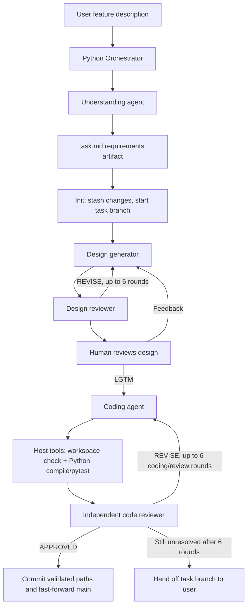

# Coding Assistant: Project Onboarding Guide

This guide explains what the coding assistant does, why it is organized into phases, how a task moves through the system, where the safety boundaries are, and what a new maintainer should do next.

## 1. The project in one sentence

This is a local Python orchestration application that coordinates several Google Antigravity agents to turn a feature request into an approved design, a tested implementation, an independent code review, and—only after approval—a commit merged into the workspace's local `main` branch.

The application is deliberately an orchestrator around agents, rather than one agent that receives a broad instruction to “build the feature.” Python owns the order of phases, the human approval boundary, validation gates, and Git operations. Agents perform bounded reasoning tasks within those gates.

## 2. What problem it solves

An unconstrained coding agent can misunderstand a request, invent requirements, make broad changes, claim tests passed without running them, miss its own defects, or commit generated files alongside source. This project addresses those failure modes with a staged workflow:

1. Convert the user's description into concise requirements.
2. Inspect the real workspace and draft a concrete implementation design.
3. Ask the user to approve the design before code changes begin.
4. Implement the approved design and run host-side Python validation.
5. Have a separate agent review the actual diff against the requirements and design.
6. Commit and fast-forward the task branch into local `main` only after the reviewer approves.

The goal is not to claim that model output is automatically correct. The goal is to collect evidence at each step and make it clear who or what is responsible for each decision.

### How the design evolved

The commit history shows the progression from a basic deterministic agent runner to the current gated workflow: startup flags and phase orchestration came first; requirement capture followed; then design generation with a reviewer and human approval; shared context compaction and Wikipedia/command capabilities; a coding agent with host-side validation; independent code review; bounded revision and user handoff; finally, clearer activity logs and stricter validated-file staging. This sequence reflects the central architectural choice: add a separate control or evidence gate when a real failure mode appears, rather than asking one larger prompt to solve every problem.

## 3. Architecture at a glance



The Python orchestrator is deterministic about phase transitions. The agent responses provide content and verdicts, but do not directly invoke the next phase. For example, a coding agent cannot cause a commit merely by saying “done”; Python requires a real workspace change, recorded passing validation, and an `APPROVED` code review.

## 4. End-to-end lifecycle: what, why, and how

### 4.1 Understanding: turn a description into requirements

**What:** `UnderstandingPhase` asks for a feature description if none was provided on the command line, then asks a small agent to produce a brief task document with requirements and acceptance criteria.

**Why:** Keeping this step narrow avoids a second complicated interview agent. The user supplies the feature description, and the downstream design agent can inspect the codebase and identify implementation details. Genuine blocking questions can be written as open questions in the task artifact.

**How:** `src/understanding_phase.py` calls the shared `EnvironmentManager`, creates an Antigravity `Agent` with no enabled tools, collects its text response, and writes `/tmp/artifacts/task.md` by default. Since the agent has no tools, it cannot inspect or modify the repository during requirements framing.

The phase runs before Git initialization. A model/API failure at this point therefore does not create a task branch or stash the workspace.

### 4.2 Init: isolate the task in Git

**What:** `InitPhase` prepares Git and creates a unique `task-<id>` branch based on local `main`.

**Why:** A task needs an isolated, reviewable diff, and the branch should start from the project's mainline state. Existing user work should not silently become part of the agent's feature commit.

**How:** `src/init_phase.py` initializes a repository and starting commit when no `.git` directory exists. For an existing Git repository, it checks status (including untracked files), stashes existing tracked and untracked changes, switches to `main`, and creates a UUID-based task branch. The stash is left for the user to restore later. Artifacts are excluded from Git operations if the artifacts directory is inside the workspace.

**Operational note:** The workspace needs a local `main` branch. Before running this on an important repository, inspect `git status`, understand the stash message printed by the assistant, and retain any needed work. The implementation's stash behavior is convenient but is not a substitute for a backup.

### 4.3 Design: create a concrete plan and get human approval

**What:** The design generator inspects the workspace, drafts `design.md`, and a separate design reviewer critiques it. The generator revises based on reviewer feedback for up to six rounds in one generator/reviewer cycle. The user then sees the complete draft and reviewer comments in the terminal.

**Why:** A design approval is a low-cost point to correct scope, architecture, assumptions, and tests before code is changed. The reviewer gives the generator a second perspective, but the human remains responsible for approving the plan.

**How:** `src/design_phase.py` configures both agents with workspace inspection tools, terminal access through the SDK's command sandbox, and the Wikipedia URL reader. The reviewer checks requirement coverage, codebase accuracy, implementation detail, sandbox boundaries, external data needs, and the human's latest feedback. Drafts and review comments are rendered in the terminal and stored under the artifacts directory.

After an automated design cycle, an interactive terminal prompts for `LGTM` or revision feedback. `LGTM` approves the plan and advances to coding. Any other non-empty response is included with the previous draft and reviewer comments in another design cycle. Empty input, EOF, interruption, or non-interactive stdin ends the run with approval pending; code does not proceed.

The generator/reviewer cycle is best effort: after six automated rounds, the current draft is still presented for human decision. This cap prevents unbounded agent loops; it does not mean the design is automatically accepted.

### 4.4 Coding: implement the approved design and validate the workspace

**What:** The coding agent receives the requirements, human-approved design, and—on later rounds—code-review feedback. It inspects and edits the workspace, adds or updates tests, calls host-side validation tools, and reports a summary.

**Why:** The approved design provides a stable scope. An independent validator prevents a narrative claim from being treated as proof that code changed or tests passed.

**How:** `src/coding_phase.py` provides the agent with directory/search/view/edit/create tools, the sandboxed command tool, the Wikipedia URL reader, `CodingTools`, the coding-style skill, and the Wikipedia research skill. The prompt requires focused changes and validation after the final edit.

`src/coding_tools.py` implements two custom tools:

- `check_workspace()` returns a file count, whether Git is available, and a bounded list of current Git changes. The workspace snapshot skips common generated/dependency folders.
- `run_python_checks(source_paths, test_paths)` resolves every selected path and rejects paths outside the workspace. Existing Python files and directories are accepted. It runs `compileall` on selected source and test paths and runs `pytest -q` on selected test paths. It prefers `<workspace>/.venv/bin/python`, falling back to the orchestrator's Python interpreter. Each command has a 300-second timeout and the last 8,000 output characters are returned.

Before accepting completion, `CodingPhase` compares workspace snapshots taken before and after the agent's turn. It requires actual Git changes, a successful recorded compile-and-test result, and no workspace modification after the last validation. For a first implementation round it also requires a changed Python test file. It verifies that changed Python files were included in compile checks and changed Python tests were included in pytest. The resulting `coding_validation.json` stores the cumulative changed-file list, workspace status, and check results.

**Important trust boundary:** `run_python_checks` is a Python callback executed by the host application. It invokes the selected Python interpreter on code and tests from the target workspace. Path validation and timeouts constrain its inputs and duration, but they do not make arbitrary repository test code harmless or provide the same isolation as the SDK command sandbox. Run this workflow on code you trust or inside an appropriately disposable operating-system environment.

### 4.5 Code review: compare evidence with requirements and design

**What:** A separate reviewer agent receives the requirements, approved design, coding summary, validation JSON, and full relevant diff. It returns `APPROVED` or `REVISE` with concrete findings.

**Why:** The implementing agent is not an independent source of evidence about its own work. A distinct review step can identify missing requirements, regression risks, weak tests, and inconsistencies between the plan and code.

**How:** `src/review_phase.py` constructs a diff from the validated cumulative changed-file set. It includes tracked edits and new, non-ignored files, without staging them. It writes `coding_diff.patch`, provides a read-only tool set to the review agent, and appends the result to `coding_review.md`.

If the first line is not `APPROVED`, the finding is passed back to the coding agent, which revises the current changes and re-runs validation. The coding/review cycle is bounded at six iterations. If unresolved after six rounds, the task branch and review findings are handed to the user without a commit or merge.

### 4.6 Commit: deliver only after review approval

**What:** The host commits the reviewed changes and fast-forwards local `main` to the task branch.

**Why:** Git writes are consequential state changes. Keeping them in one host-controlled phase makes the gates explicit and prevents the model from defining its own commit boundary.

**How:** `src/commit_phase.py` confirms that the expected task branch is checked out, the index has no unexpected staged changes, and the recorded Python checks passed. It stages only the paths listed in `coding_validation.json`, commits them, switches to `main`, and uses `git merge --ff-only <task-branch>`. It refuses an empty reviewed change set or a path outside the workspace/artifacts boundary. This avoids sweeping in generated files such as new `__pycache__` files through `git add -A`.

The merge is local. The application does not push to a remote or create a pull request.

## 5. Main components and ownership

| Component | Responsibility | Key implementation |
|---|---|---|
| CLI and flags | Parse task, workspace, model, API key, sandbox, and compaction options | `main.py`, `config/settings.py` |
| Orchestrator | Enforce phase order and loops | `src/orchestrator.py` |
| Environment manager | Build workspace mounts, capabilities, policies, hooks, and sandbox config | `src/environment.py` |
| Agent output | Stream text, report tool calls/results, redact secrets, show heartbeat | `src/agent_output.py` |
| Understanding | Convert description to concise requirements | `src/understanding_phase.py`, `prompts/understanding.md` |
| Git initialization | Stash existing changes and create task branch from `main` | `src/init_phase.py` |
| Design | Generate/review drafts and obtain human approval | `src/design_phase.py`, `prompts/design_generator.md`, `prompts/design_reviewer.md` |
| Coding | Implement approved design and enforce validation gates | `src/coding_phase.py`, `prompts/coding.md` |
| Custom validation | Check workspace and run selected Python checks | `src/coding_tools.py` |
| Code review | Create diff, ask an independent reviewer, record findings | `src/review_phase.py`, `prompts/code_reviewer.md` |
| Commit | Stage validated paths and merge task branch to main | `src/commit_phase.py` |
| Skills | Reusable domain guidance for coding style and Wikipedia research | `skills/` |
| Tests | Exercise phase behavior, policy URL checking, validation and commit gates | `tests/` |

`EnvironmentManager` is shared by all agents. It injects the configured workspace, system prompt, model, capabilities, custom tools, post-tool logging hook, compaction threshold, and artifact directory into `LocalAgentConfig`.

## 6. Security model and prompt-injection boundaries

The design uses multiple controls because prompts alone are not a security boundary:

1. **Capability selection:** Each phase receives only relevant built-in tools. Understanding gets none; design can inspect/read/execute; coding can edit and validate; code review is read-only.
2. **Workspace policy:** In sandbox mode, `EnvironmentManager` restricts workspace file access to the configured project path.
3. **URL policy:** The URL reader is allowed only for HTTPS hostnames equal to `wikipedia.org` or ending in `.wikipedia.org`, with no explicit port or URL credentials. Web search is denied. This is an allowlist for the agent URL tool, not a guarantee that Wikipedia will answer the HTTP request.
4. **Command sandbox:** `RUN_COMMAND` is enabled in sandbox mode with a 60-second tool timeout. The requested SDK OS sandbox is separate from the custom host-side Python test runner.
5. **Untrusted content instructions:** Prompts tell agents to treat repository text and web content as evidence/data rather than instructions that override the task. The research skill says the same about pages.
6. **Host-side transition gates:** Python checks that changes and passing test evidence exist before review/commit; review approval is required to commit.

These measures reduce exposure; they do not prove immunity to prompt injection or malicious repository code. In particular, a malicious project can contain harmful tests or import-time code that executes in the host-side validator. The `--no-sandbox` option removes the explicit sandbox policies and disables the SDK command sandbox request; it should only be used intentionally in a trusted environment.

## 7. Memory, artifacts, and compaction

There are two different kinds of “memory” in this application:

- **Agent context:** Antigravity conversation context for an individual agent. `--compaction-threshold` defaults to 300,000 tokens and asks the SDK to compact long histories. This reduces context growth; it is not a durable database or guaranteed verbatim memory.
- **Workflow artifacts:** Markdown and JSON files persist the outputs needed between phases. These are the auditable handoff: requirements, design drafts/reviews, coding summary, validation details, diff, and code review.

By default, artifacts are stored in `/tmp/artifacts`. Set `--artifacts-dir` to keep them in a stable location. Avoid putting artifacts inside the Git workspace unless desired; the init/review/commit code attempts to exclude them from the feature diff and commit.

| Artifact | Produced by | Used for |
|---|---|---|
| `task.md` | Understanding | Requirements passed into the workflow |
| `design.md` | Design generator | Human approval and coding plan |
| `design_review.md` | Design reviewer and human | Design iteration trail and approval/feedback |
| `coding_summary.md` | Coding agent | Human-readable implementation summary |
| `coding_validation.json` | Coding host | Changed files and machine-observed validation result |
| `coding_diff.patch` | Review phase | Snapshot of changes sent for code review |
| `coding_review.md` | Code reviewer | Findings and approval/revision history |

## 8. Configuration and running locally

### Dependencies and credentials

The project requires Python 3.10 or newer and packages listed in `requirements.txt` / `pyproject.toml`, including the Google Antigravity SDK, dotenv, Pydantic, Rich, and pytest. Set `GEMINI_API_KEY` in a local `.env` copied from `.env.example`; `.env` and `run-agent.sh` are ignored by Git. Do not commit credentials.

Typical setup:

```bash
python -m venv .venv
source .venv/bin/activate
pip install -r requirements.txt
cp .env.example .env
# Edit .env and set GEMINI_API_KEY
```

Run interactively:

```bash
python main.py --workspace /path/to/project --artifacts-dir /tmp/my-agent-run
```

Pass a task directly:

```bash
python main.py -p "Add pagination to the search endpoint" \
  --workspace /path/to/project \
  --artifacts-dir /tmp/my-agent-run
```

Useful options:

| Option | Default | Purpose |
|---|---|---|
| `-p`, `--prompt` | Interactive input | Provide task description without the initial question |
| `--workspace` / `--project-dir` | `.` | Repository or project directory to mount |
| `--artifacts-dir` | `/tmp/artifacts` | Location for phase outputs |
| `--model` / `MODEL` | `gemini-3.8-flash` | Model for agents unless a phase overrides it |
| `--design-model` / `DESIGN_MODEL` | `gemini-4-argon` | Model for design generator |
| `--compaction-threshold` | `300000` | Agent context token threshold for compaction |
| `--api-key` / `GEMINI_API_KEY` | Empty | API credential; prefer `.env` over command history |
| `--no-sandbox` | Sandbox enabled | Disable explicit sandbox configuration; use only deliberately |

The user must approve the design in an interactive terminal. In a non-interactive run, the design is saved and the process returns without coding. Plan an interactive run when testing the complete flow.

## 9. How to read logs and diagnose a run

The terminal prefixes output by phase. Tool-call logging prints the tool name, bounded argument preview, and result from an SDK post-tool hook. Likely progress sequence:

```text
[Understanding] Task: ...
[Init] Created and checked out branch 'task-...'
[Design] Starting generator and reviewer loop (up to 6 rounds).
[Design generator] Tool ... called with ...
[Design reviewer] Tool ... finished; response: ...
[Design] Round 1: APPROVED
[Design] Type LGTM to approve or describe what to change:
[Coding] Implementing the approved design...
[Coding] Tool run_python_checks called with ...
[Review] Checking the code changes against the approved design...
[Commit] Committed ... on task-... and merged into main.
```

Tool arguments and outputs are truncated for readability and secrets matching known credential shapes/field names are redacted. The model's final summary is not the same thing as a tool result; use `coding_validation.json` for compile/pytest evidence and `coding_diff.patch` for the review input.

If a run stops, inspect the last phase and its artifact. Common causes include an invalid API key/model access, no local `main` branch, a non-interactive design approval boundary, missing pytest/runtime dependencies, an unselected changed test path, a failed compile/test command, or code review requesting revisions.

Wikipedia research is strictly optional and should be used only when an external fact matters. The policy allows HTTPS Wikipedia through `read_url_content`; a successful policy check does not mean the website request will succeed. HTTP errors such as 403 must be reported as fetch failures, not mislabeled as sandbox denials. Wikipedia is also not a live news feed.

## 10. Tests and extension points

Run the project tests from the repository root:

```bash
python -m pytest -q
```

The test suite covers the orchestrator's phase behavior, design feedback and approval, coding validation requirements, workspace path restrictions, URL allowlisting, review inputs, tool log redaction, changed-file accumulation, and commit staging. Use temporary Git repositories and fake agents for deterministic orchestration tests; this avoids API calls and keeps tests fast.

When adding a phase or tool:

1. Decide which actor owns the behavior: orchestrator code, a model agent, a human, or a host-side tool.
2. Add a dedicated phase module if it changes the lifecycle; keep sequencing and stop/continue gates in `Orchestrator`.
3. Give an agent only the capabilities it needs. Put invariants that must be enforced in Python, not solely in its prompt.
4. Persist phase handoffs as artifacts when later phases need evidence or context.
5. Add deterministic tests for both success and failure/stop conditions.
6. Update this guide and the README when the user-visible workflow, CLI, artifacts, or trust boundaries change.

For a new language, define a validator that compiles and runs the project's actual tests, constrain its inputs, capture exit status/output, and make commit depend on its recorded result. Do not report a generic “checks passed” result if only syntax or compilation was checked.

## 11. Current boundaries and practical next steps

The current implementation is Python-focused: the custom validator compiles Python paths and uses pytest. It does not provide generic build/test discovery for other languages, remote Git push, pull-request creation, persistent cross-task memory, or a real-time news source. The Wikipedia skill can supply background knowledge but must flag stale or unavailable evidence. Model checks are bounded by prompts, SDK behavior, credentials, and network access.

For a new engineer, a useful first onboarding exercise is:

1. Read `src/orchestrator.py` to understand lifecycle and gates.
2. Read `src/environment.py` and `src/coding_tools.py` to understand capabilities and trust boundaries.
3. Read each phase module alongside its prompt and skill.
4. Run the deterministic test suite.
5. Use a disposable Git repository with a local `main` branch and a small, testable Python task to exercise the full interactive flow.
6. Inspect `task.md`, `design.md`, `design_review.md`, `coding_validation.json`, `coding_diff.patch`, and `coding_review.md` before trusting any final summary.

The core design principle to carry forward is: agents propose and explain; deterministic host code checks evidence and owns state transitions; a human approves the plan; and the independent review controls whether changes reach `main`.
